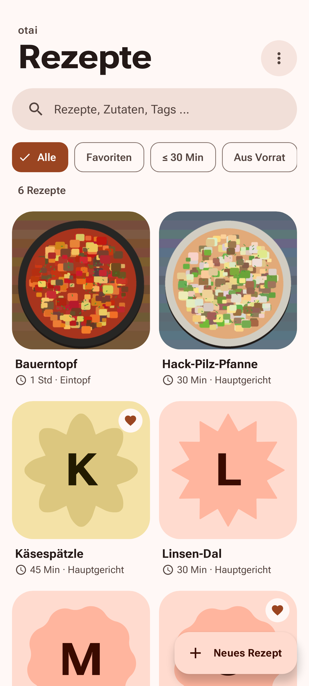
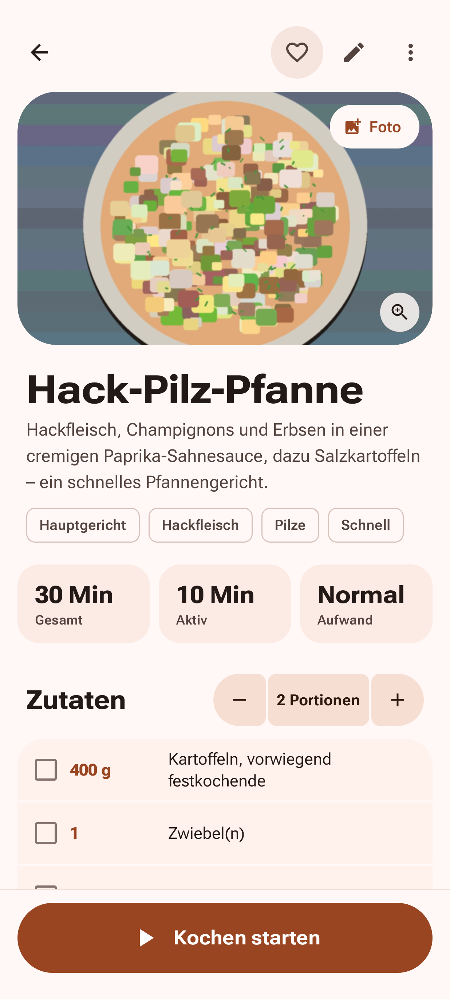
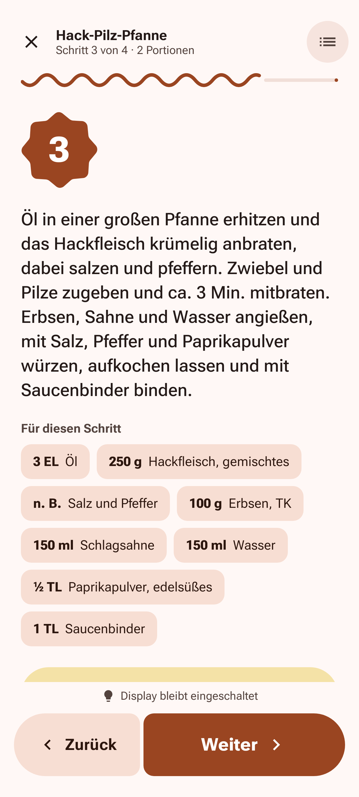
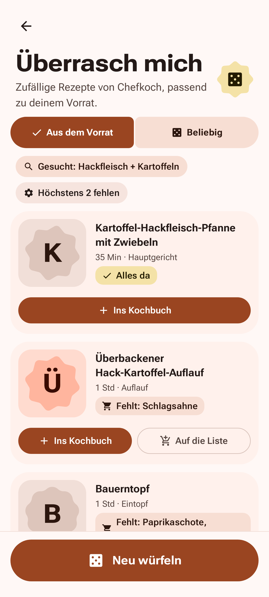

# otai

Rezept-App für Android im Stil von Material 3 Expressive: Rezepte sammeln, kochen, Woche planen, einkaufen.
Ohne Google Play Services, ohne Tracking, ohne Konto – alle Daten bleiben auf dem Gerät.

<p>
  
  
  
  
</p>

## Installieren

**Mit [Obtainium](https://github.com/ImranR98/Obtainium) (empfohlen, mit automatischen Updates):**
1. Obtainium installieren und öffnen.
2. „App hinzufügen“ → als Quelle `https://github.com/owbua/otai` eintragen → „Hinzufügen“.
3. „Installieren“ antippen. Neue Versionen meldet Obtainium von selbst.

**Ohne Obtainium:** die neueste `otai-v….apk` unter [Releases](https://github.com/owbua/otai/releases) herunterladen und öffnen.

Voraussetzung: Android 8.0 oder neuer.

> **Umstieg von „Kochbuch“:** otai ist für Android eine neue App. In der alten App unter
> ⋮ → Einstellungen → *Alle exportieren* ein Backup speichern, in otai unter ⋮ → Einstellungen →
> *Datei importieren* laden. Rezepte, Fotos, Notizen, Wochenplan, Einkaufsliste und Vorrat sind dann übernommen.

## Funktionen

- **Übersicht:** Suche über Titel, Tags und Zutaten; Filter (Favoriten, ≤ 30 Min, **Aus Vorrat**, häufigste Tags); Kacheln mit MaterialShapes oder eigenem Foto; Mehrfachauswahl (lange drücken) zum Löschen, Teilen oder Exportieren.
- **Rezeptansicht:** Portionen-Stepper mit skalierten Mengen, Zutaten zum Abhaken, Tipps, Nährwerte, Notizen; Foto antippen zum Zoomen.
- **Kochansicht:** ein Schritt pro Bildschirm, Zutaten „für diesen Schritt“, mehrere Timer parallel (mit Benachrichtigung), Display bleibt an.
- **Rückmeldung nach dem Kochen:** Bewertung, Mengen anpassen, Notiz – geänderte Mengen gehen direkt ins Rezept, dazu eine datierte Änderungsnotiz.
- **Wochenplan** mit begründeten Vorschlägen (Abwechslung, gemeinsame Zutaten, Favoriten, „lange nicht gekocht“).
- **Einkaufsliste** automatisch aus dem Plan, zusammengefasst und skaliert; **Vorrat** und Grundzutaten werden berücksichtigt; als Text teilen.
- **Überrasch mich:** zufällige Rezepte von chefkoch.de – passend zum Vorrat (einstellbar, wie viele Zutaten fehlen dürfen) oder ganz beliebig; fehlende Zutaten per Tipp auf die Einkaufsliste.
- **Import:** von Webseiten mit schema.org/Recipe (z. B. Chefkoch) per Link oder *Teilen → otai*, als JSON, als Rezept-Paket (ZIP mit Fotos) oder als Backup.
- **Export:** einzelne Rezepte als JSON, Auswahl als Rezept-Paket, alles als Backup-ZIP.
- **Rezepte mit KI umwandeln:** Der Prompt unter ⋮ → Einstellungen → *KI-Prompt kopieren* macht aus PDF, Foto oder Text ein importierbares Rezept.

## Rezeptformat

Rezepte sind schlichte JSON-Dateien im Format `kochbuch-rezept/1` (der Name stammt aus der Zeit vor der Umbenennung und bleibt aus Kompatibilitätsgründen).
Beschreibung: [`rezept-format/SCHEMA.md`](rezept-format/SCHEMA.md), JSON-Schema: [`rezept-format/rezept.schema.json`](rezept-format/rezept.schema.json),
Beispiele: [`rezept-format/beispiele/`](rezept-format/beispiele), Prompt: [`rezept-format/claude-prompt.md`](rezept-format/claude-prompt.md).

## Internet und Datenschutz

Die App geht nur ins Netz, wenn du es auslöst: Import von einer Webseite, Foto von der Originalseite nachladen oder „Überrasch mich“.
Blockiert eine Seite einfache Abrufe, lädt die App sie unsichtbar in der System-WebView – wie ein Browser. Es gibt keine Analyse, keine Werbung und keinen eigenen Server.

## Selbst bauen

Voraussetzungen: JDK 17 oder neuer, Android SDK mit Plattform 37.

```bash
./gradlew testDebugUnitTest   # Unit-Tests, rendert Screenshots nach app/screenshots/
./gradlew assembleDebug       # Debug-APK
./gradlew assembleRelease     # Release-APK (ohne Release-Schlüssel mit dem lokalen Debug-Schlüssel signiert)
```

Technik: Kotlin, Jetpack Compose, material3 (Expressive), Navigation Compose, kotlinx.serialization; Screenshot-Tests mit Robolectric und Roborazzi. minSdk 26, targetSdk 36.

### Releases

Ein Tag `vX.Y.Z` (passend zu `versionName` in `app/build.gradle.kts`) startet den Workflow [`release.yml`](.github/workflows/release.yml):
Tests, signierter Release-Build, Signaturprüfung, GitHub-Release mit `otai-vX.Y.Z.apk`.
Der Signaturschlüssel liegt nur als Repository-Secret vor (`OTAI_KEYSTORE_BASE64`, `OTAI_KEYSTORE_PASSWORD`), nie im Repo.

## Entstehung

otai ist mit [Claude Code](https://claude.com/claude-code) entstanden: Der Code wurde von der KI geschrieben, Ideen, Design-Vorgaben und Tests am Gerät kamen von mir.
Funktionsideen stammen unter anderem aus [openCook](https://github.com/oliexdev/openCook) (Web-Import, Wochenplan, Einkaufsliste) und [Voice](https://github.com/PaulWoitaschek/Voice) (Übergangsanimationen) – übernommen wurde nur die Idee, kein Code.

## Lizenz

otai steht unter der [GNU General Public License v3.0](LICENSE).

Enthaltene Fremdbestandteile:
- Schrift **Roboto Flex** – SIL Open Font License 1.1 ([`app/src/main/assets/RobotoFlex-OFL.txt`](app/src/main/assets/RobotoFlex-OFL.txt))
- **Material Symbols** (als Vektorpfade) – Apache License 2.0
